# Ripple

A small, fast social network: share short posts, follow people, like and reply, and get notified when someone engages with you. Built with **Node.js, Express, PostgreSQL and framework-free JavaScript**, with a layered backend and an accessible, responsive frontend.

**Live demo:** https://ripple-rho-seven.vercel.app

| Demo access           |                                                                        |
| --------------------- | ---------------------------------------------------------------------- |
| One click             | Press **Try the demo account** on the login page                       |
| Username / password   | `demo` / `ripple-demo-2026`                                            |
| Other seeded accounts | `maya_codes`, `liamdesigns`, `sofia.lens`, `dev_noah`… (same password) |

Feel free to post, like, comment and follow; the demo data is regenerated for fresh databases.

## Contents

- [Screenshots](#screenshots)
- [Features](#features)
- [How to use Ripple](#how-to-use-ripple)
- [Tech stack](#tech-stack)
- [Architecture](#architecture)
- [API reference](#api-reference)
- [Using the API from the command line](#using-the-api-from-the-command-line)
- [Local setup](#local-setup)
- [Configuration](#configuration)
- [Deployment](#deployment)
- [Security](#security)
- [Performance](#performance)
- [Tech decisions and trade-offs](#tech-decisions-and-trade-offs)
- [Troubleshooting](#troubleshooting)
- [CI](#ci)

## Screenshots

| Home feed (dark)                                                     | Profile (light)                                                   |
| -------------------------------------------------------------------- | ----------------------------------------------------------------- |
| 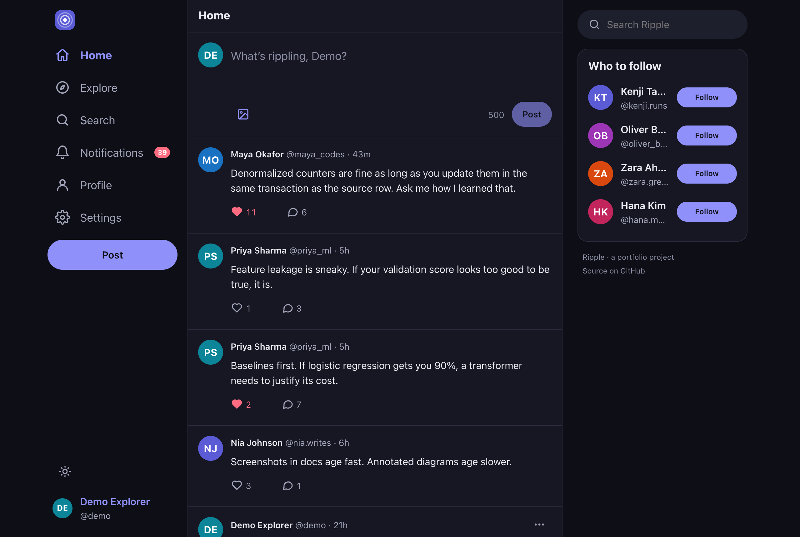       | 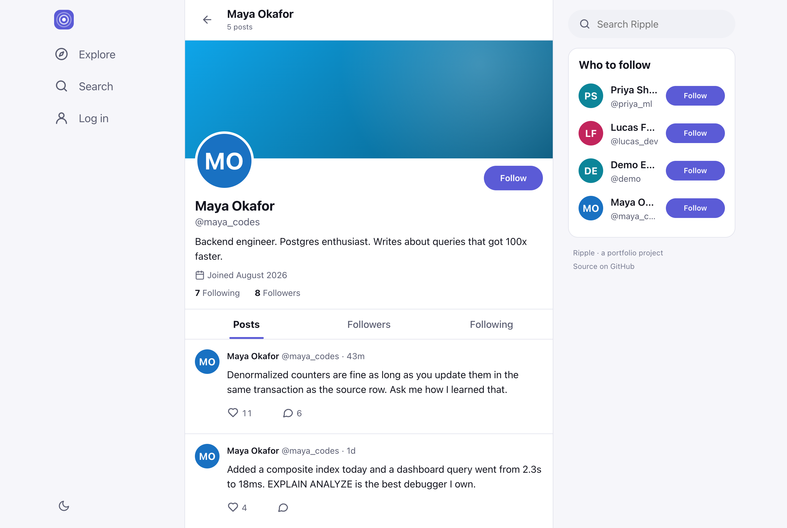 |
| **Post with threaded comments**                                      | **Notifications**                                                 |
| 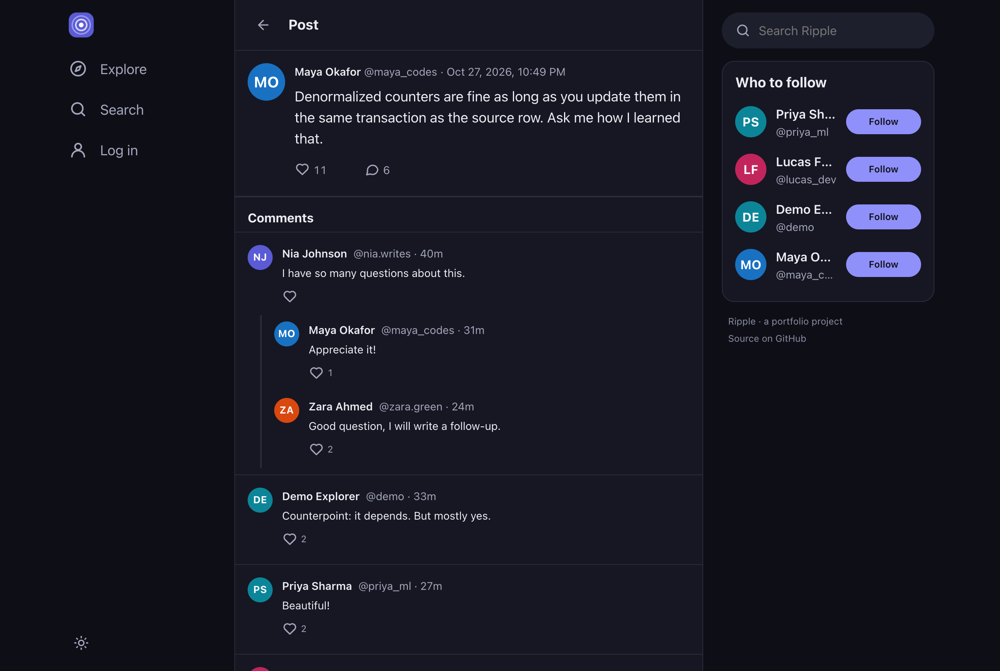  | 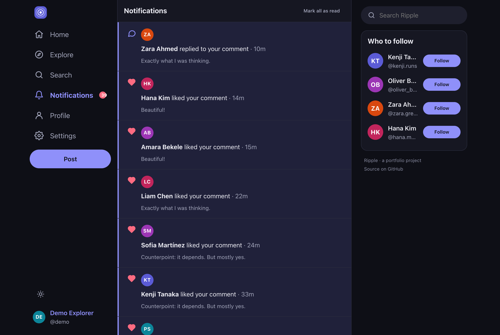    |
| **Trending on Explore**                                              | **Login with demo access**                                        |
| 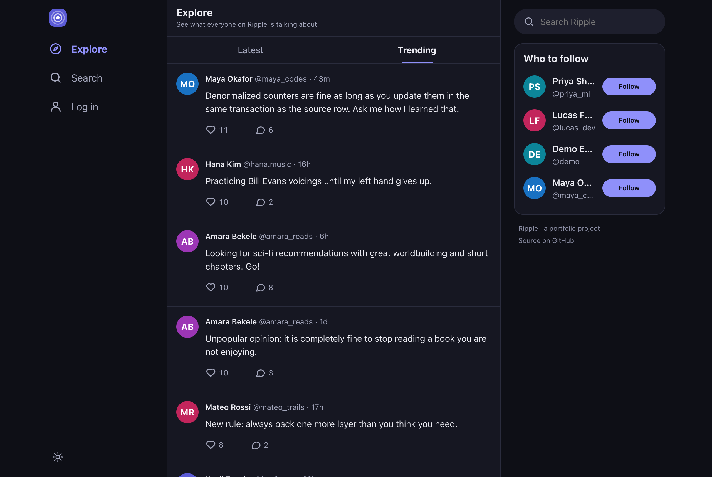 | 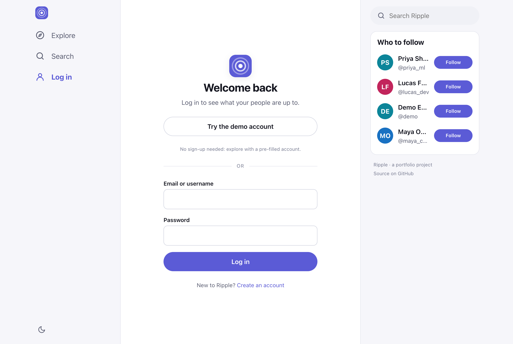                   |

| Mobile home                                                                          | Mobile search                                                                               |
| ------------------------------------------------------------------------------------ | ------------------------------------------------------------------------------------------- |
| 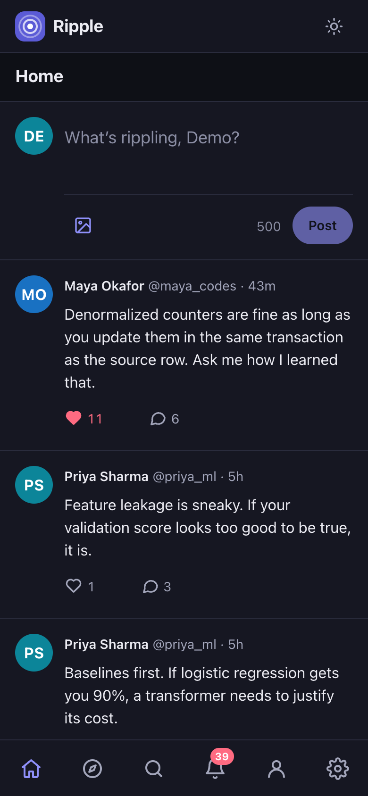 | 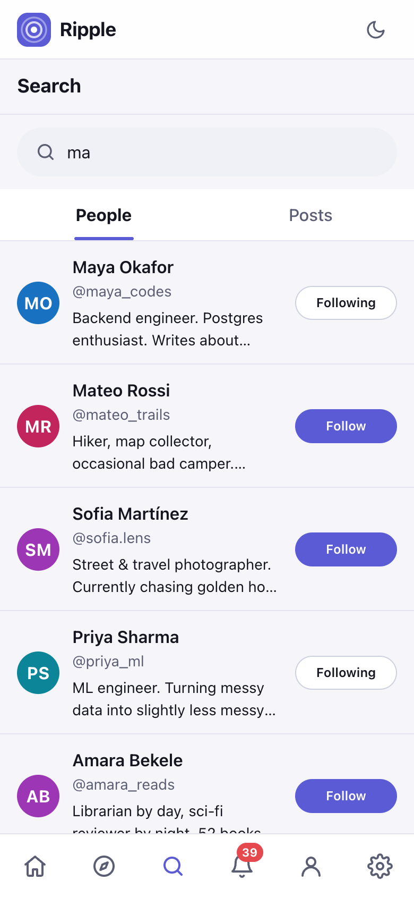 |

## Features

- **Accounts:** register, log in with email or username, log out, persistent sessions, change password (signs out every other device).
- **Profiles:** display name, bio, avatar (Cloudinary, with generated initials fallback), banner color, join date, post/follower/following counts, public page at `/u/:username`.
- **Posts:** 500-character posts with an optional image, live character counter, inline editing, deletion, relative timestamps that stay fresh, links, `@mentions` and `#hashtags`.
- **Comments:** comments and one level of replies (replying to a reply joins the same thread), likes on comments, post authors can moderate their threads.
- **Likes and follows:** optimistic UI with rollback on failure; idempotent and race-safe on the server.
- **Feeds:** "Following" home timeline and "Explore" with Latest and Trending (most liked in the last 48 hours), all with cursor-based infinite scroll.
- **Who to follow:** friends-of-friends ranked by mutual connections, topped up with the most-followed users.
- **Search:** people (ranked: exact username, prefix, trigram similarity, popularity) and posts (stemmed full-text search plus substring fallback), debounced as you type.
- **Notifications:** follows, likes, comments and replies, with an unread badge and "mark all as read"; undoing a like or follow withdraws its notification.
- **Polish:** light/dark/system theme, mobile-first layout, keyboard accessible, skeleton loaders, empty states, toasts, a clear error page and a 404 page.

## How to use Ripple

This section walks through the app as a user. Everything works the same on the [live demo](https://ripple-rho-seven.vercel.app) and on a [local copy](#local-setup).

### 1. Get in

- **Look around first:** signed-out visitors land on **Explore** and can read posts, profiles, comments and search results. Liking, commenting, posting and following ask you to sign in.
- **Use the demo account:** on **Log in**, press **Try the demo account**. You are signed in as `@demo`, who already follows people and has notifications waiting.
- **Create your own account:** go to **Sign up** and enter an email, a username, a display name and a password (see [Rules and limits](#rules-and-limits)).
- **Log in later** with either your email or your username. Sessions last 7 days, even after you close the browser.

### 2. Find people and follow them

- On wide screens, the **Who to follow** panel in the right-hand column suggests friends of friends, ranked by how many people you have in common. On phones and tablets, use **Search** or browse **Explore** instead.
- Open **Search**, type a name or username, and pick a person. Results update as you type.
- On a profile, press **Follow**. The button switches to **Following**; press it again to unfollow.
- Every profile has **Posts**, **Followers** and **Following** tabs, and each person in those lists has their own follow button.

### 3. Read your feeds

| Feed                   | Where                    | What it shows                                             |
| ---------------------- | ------------------------ | --------------------------------------------------------- |
| **Home**               | `/` (signed in)          | Your posts and posts from people you follow, newest first |
| **Explore · Latest**   | `/explore`               | Every post on Ripple, newest first                        |
| **Explore · Trending** | `/explore?sort=trending` | Posts from the last 48 hours with the most likes          |

Feeds load more posts as you scroll. If a page of results fails to load, a **Retry** button appears instead of a blank list.

### 4. Post

1. On **Home**, write in the box at the top ("What’s rippling, …?"). The counter shows how many of the 500 characters are left.
2. Optionally press the image button to attach a photo (JPEG, PNG, GIF or WebP, up to 4 MB). A preview appears and can be removed before posting. Image uploads need [Cloudinary](#configuration) to be configured.
3. Press **Post**, or use <kbd>Ctrl</kbd>/<kbd>⌘</kbd> + <kbd>Enter</kbd>.

In any post or comment, `@username` links to that profile, `#hashtag` searches for the tag, and web addresses become links.

To **edit** or **delete** one of your posts, use the **⋯** (Post options) menu on the post. Edited posts show an "edited" label; deleting asks for confirmation first.

### 5. Like, comment and reply

- Press the heart on a post or comment to like it; press again to unlike. The count updates instantly and rolls back if the request fails.
- Open a post (click its text or the comment icon) to see the conversation. Write a comment in the box at the top of **Comments**.
- Press **Reply** under a comment to answer it; the reply starts with `@their_username` and appears in that thread. Long threads show **View N more replies**.
- In comment and reply boxes, <kbd>Ctrl</kbd>/<kbd>⌘</kbd> + <kbd>Enter</kbd> sends and <kbd>Esc</kbd> cancels a reply.
- You can delete your own comments. As the author of a post, you can also delete any comment on it. Deleting a comment also removes its replies.

### 6. Notifications

The bell in the navigation shows a badge with your unread count, refreshed every 30 seconds. **Notifications** lists who followed you, liked your posts or comments, commented on your posts and replied to your comments, each linking to the post or profile. Press **Mark all as read** to clear the badge. If someone unlikes or unfollows, the matching notification disappears.

### 7. Make the profile yours

On your profile, press **Edit profile** to change:

- your display name (up to 50 characters) and bio (up to 160 characters)
- your banner color
- your photo (**Upload photo**, JPEG/PNG/GIF/WebP up to 2 MB, or **Remove** to go back to the generated initials avatar)

### 8. Settings

- **Appearance:** choose Light, Dark or System. The sun/moon button in the navigation switches quickly between light and dark. Your choice is remembered on this device.
- **Change password:** enter your current and new password. Every other device you are signed in on is signed out; this one stays signed in.
- **Account:** shows your username and email, and has **Log out**.

### Rules and limits

| Item          | Rule                                                                                         |
| ------------- | -------------------------------------------------------------------------------------------- |
| Username      | 3–30 characters: letters, numbers, `_` and `.` (no leading, trailing or double dots); unique |
| Display name  | 1–50 characters                                                                              |
| Password      | 8–72 characters                                                                              |
| Bio           | Up to 160 characters                                                                         |
| Post, comment | 1–500 characters                                                                             |
| Post image    | JPEG, PNG, GIF or WebP, up to 4 MB                                                           |
| Avatar        | JPEG, PNG, GIF or WebP, up to 2 MB                                                           |
| Rate limits   | 20 sign-in/sign-up attempts per 15 minutes; 60 writes per minute                             |

### Pages

| URL                                  | Page                                          |
| ------------------------------------ | --------------------------------------------- |
| `/`                                  | Home feed (signed-out visitors go to Explore) |
| `/explore`, `/explore?sort=trending` | Explore: latest or trending                   |
| `/search?q=…`                        | People and post search                        |
| `/p/:postId`                         | A post with its comments                      |
| `/u/:username`                       | Profile (`/followers` and `/following` tabs)  |
| `/notifications`                     | Notifications (signed in)                     |
| `/settings`                          | Appearance, password and account (signed in)  |
| `/login`, `/register`                | Log in and sign up                            |

### Keyboard and accessibility

- Everything is reachable with <kbd>Tab</kbd>; a **Skip to content** link comes first.
- <kbd>Ctrl</kbd>/<kbd>⌘</kbd> + <kbd>Enter</kbd> submits the post, comment or reply box you are typing in.
- <kbd>Esc</kbd> closes dialogs and menus and cancels a reply.
- After each page change, focus moves to the page heading so screen readers announce the new page; loading lists are marked busy.
- Animations are turned off when the system asks for reduced motion.

## Tech stack

| Layer    | Choice                                                                                                    |
| -------- | --------------------------------------------------------------------------------------------------------- |
| Runtime  | Node.js 20+, ES modules                                                                                   |
| API      | Express 5, zod validation, helmet, compression, express-rate-limit                                        |
| Database | PostgreSQL (Neon in production) via Prisma ORM and SQL migrations                                         |
| Auth     | bcrypt password hashing (bcryptjs), JWT in an httpOnly, Secure, SameSite cookie, double-submit CSRF token |
| Media    | Cloudinary (optional) with automatic format/quality delivery                                              |
| Frontend | Vanilla HTML, CSS custom properties and JavaScript modules, no build step                                 |
| Tests    | Vitest + Supertest against a real PostgreSQL database                                                     |
| Tooling  | ESLint, Prettier, GitHub Actions CI                                                                       |
| Hosting  | Vercel (serverless function + CDN) and Neon; Dockerfile for container hosts                               |

## Architecture

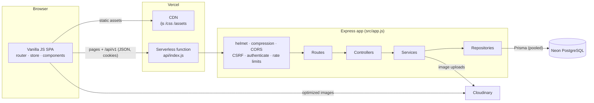

The backend is layered so each concern lives in one place:

- **Routes** declare the URL, middleware and validation schema.
- **Controllers** are thin: read the validated request, call a service, send the response.
- **Services** hold the business rules (who may delete what, threading, notifications, suggestions).
- **Repositories** are the only code that talks to Prisma, and select only the columns they need.

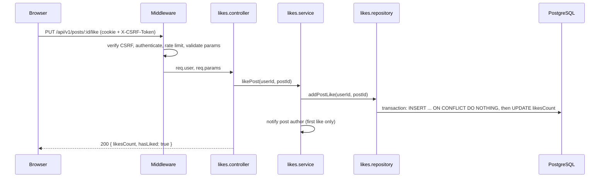

### Data model

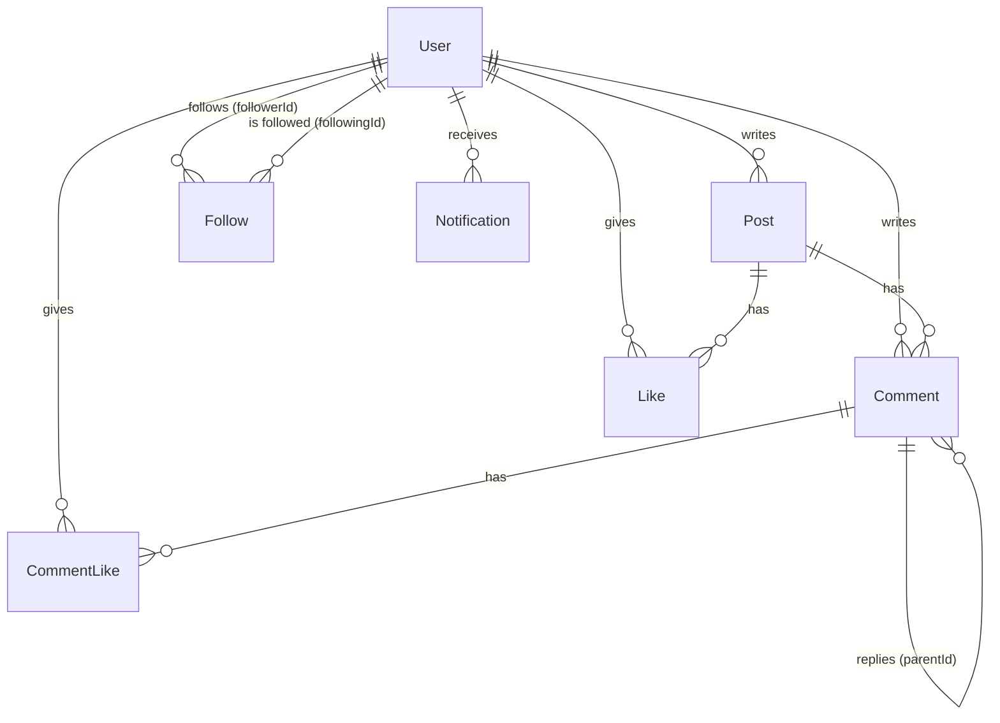

Counts (`likesCount`, `commentsCount`, `followersCount`...) are denormalized and updated in the same transaction as the row that changes them, so feeds never need `COUNT(*)` joins. Check constraints keep them non-negative and stop self-follows.

### Project structure

```text
ripple/
├── api/index.js              Vercel entry (exports the Express app)
├── prisma/                   schema.prisma, migrations/, seed.js, seedIfEmpty.js
├── src/
│   ├── app.js / server.js    app setup (no listen) / local server
│   ├── config/               env (zod-validated), database, cloudinary, logger
│   ├── middlewares/          requireAuth, validateRequest, csrfProtection, rateLimiter,
│   │                         uploadImage, serveClient, errorHandler, notFound
│   ├── modules/<feature>/    *.routes · *.controller · *.service · *.repository · *.schemas
│   │                         auth, users, posts, comments, likes, follows, feed, search,
│   │                         notifications, health
│   └── utils/                AppError, pagination, tokens, cookies, sanitize, imageType...
├── public/
│   ├── app.html              single HTML shell
│   ├── css/                  variables (design tokens), base, layout, components/*
│   └── js/                   router, routes, main, api/, components/, pages/, state/, utils/
├── tests/                    unit/ and integration/ (Vitest + Supertest)
├── .github/workflows/ci.yml  lint, format check and tests on every push
└── Dockerfile, vercel.json, .env.example
```

## API reference

Base path: `/api/v1`. Request bodies are JSON (or `multipart/form-data` for uploads). All state-changing requests need the `X-CSRF-Token` header (see [Security](#security)).

**Errors** always look like:

```json
{
  "error": {
    "code": "VALIDATION_ERROR",
    "message": "Request validation failed",
    "details": [{ "field": "body.content", "message": "Post must be at most 500 characters" }]
  }
}
```

**Lists** use cursor pagination: `?limit=20&cursor=<nextCursor>` (limit 1–50) and return `{ "data": [...], "nextCursor": "..." | null }`.

Legend: 🔒 requires a session · ⏱ rate limited

| Method            | Path                                  | Description                                                           |
| ----------------- | ------------------------------------- | --------------------------------------------------------------------- |
| GET               | `/health`                             | Service and database status                                           |
| **Auth**          |                                       |                                                                       |
| GET               | `/auth/csrf`                          | Returns the CSRF token (also set as a cookie)                         |
| GET               | `/auth/session`                       | Current user or `{ "user": null }`                                    |
| GET               | `/auth/me` 🔒                         | Current user (401 when signed out)                                    |
| POST              | `/auth/register` ⏱                    | `{ email, username, displayName, password }` → 201 and session cookie |
| POST              | `/auth/login` ⏱                       | `{ identifier, password }`; identifier is an email or username        |
| POST              | `/auth/demo` ⏱                        | Sign in as the demo account                                           |
| POST              | `/auth/logout`                        | Clears the session (204)                                              |
| PATCH             | `/auth/password` 🔒⏱                  | `{ currentPassword, newPassword }`; revokes other sessions (204)      |
| **Users**         |                                       |                                                                       |
| GET               | `/users/suggestions?limit=5`          | Who to follow                                                         |
| GET               | `/users/:username`                    | Profile with counts, `isFollowing`, `isSelf`                          |
| PATCH             | `/users/me` 🔒⏱                       | `{ displayName?, bio?, bannerColor? }`                                |
| PUT               | `/users/me/avatar` 🔒⏱                | Multipart field `avatar` (JPEG/PNG/GIF/WebP, ≤ 2 MB)                  |
| DELETE            | `/users/me/avatar` 🔒                 | Back to the initials avatar                                           |
| GET               | `/users/:username/posts`              | User's posts, newest first                                            |
| GET               | `/users/:username/followers`          | Followers, with the viewer's follow state                             |
| GET               | `/users/:username/following`          | Followed accounts                                                     |
| PUT / DELETE      | `/users/:username/follow` 🔒⏱         | Follow / unfollow (idempotent) → `{ isFollowing, followersCount }`    |
| **Posts**         |                                       |                                                                       |
| POST              | `/posts` 🔒⏱                          | `{ content }` or multipart with `content` + `image` (≤ 4 MB) → 201    |
| GET               | `/posts/:postId`                      | Single post with `hasLiked`                                           |
| PATCH             | `/posts/:postId` 🔒⏱                  | `{ content }`; owner only; sets `editedAt`                            |
| DELETE            | `/posts/:postId` 🔒                   | Owner only (204)                                                      |
| PUT / DELETE      | `/posts/:postId/like` 🔒⏱             | Like / unlike (idempotent) → `{ likesCount, hasLiked }`               |
| **Comments**      |                                       |                                                                       |
| GET               | `/posts/:postId/comments`             | Top-level comments, oldest first, each with up to 3 replies           |
| POST              | `/posts/:postId/comments` 🔒⏱         | `{ content, parentId? }` → 201                                        |
| GET               | `/comments/:commentId/replies`        | All replies of a comment                                              |
| DELETE            | `/comments/:commentId` 🔒             | Comment author or post author (204)                                   |
| PUT / DELETE      | `/comments/:commentId/like` 🔒⏱       | Like / unlike a comment                                               |
| **Feeds**         |                                       |                                                                       |
| GET               | `/feed/following` 🔒                  | Your posts and posts from people you follow                           |
| GET               | `/feed/explore?sort=recent\|trending` | Everything, or the most liked posts of the last 48 hours              |
| **Search**        |                                       |                                                                       |
| GET               | `/search/users?q=`                    | Up to 20 ranked people results                                        |
| GET               | `/search/posts?q=`                    | Matching posts, newest first, paginated                               |
| **Notifications** |                                       |                                                                       |
| GET               | `/notifications` 🔒                   | Newest first, with actor and post/comment previews                    |
| GET               | `/notifications/unread-count` 🔒      | `{ unreadCount }`                                                     |
| POST              | `/notifications/read-all` 🔒          | Mark everything as read (204)                                         |

Example:

```bash
curl -s "https://ripple-rho-seven.vercel.app/api/v1/feed/explore?sort=trending&limit=2"
```

## Using the API from the command line

The API uses the same cookies as the browser. With `curl`, keep them in a cookie jar, fetch a CSRF token once, and send it as `X-CSRF-Token` on every write:

```bash
BASE=https://ripple-rho-seven.vercel.app/api/v1
CSRF=$(curl -s -c jar.txt "$BASE/auth/csrf" | sed -E 's/.*"csrfToken":"([^"]+)".*/\1/')
curl -s -b jar.txt -c jar.txt -H "X-CSRF-Token: $CSRF" -X POST "$BASE/auth/demo"
curl -s -b jar.txt "$BASE/feed/following?limit=3"
```

Write requests without a matching header are rejected with `403 FORBIDDEN`. Delete `jar.txt` when you are done.

## Local setup

**Prerequisites:** Node.js 20+ and PostgreSQL 14+ (local, Docker or a free Neon database).

```bash
git clone https://github.com/TeamirA/ripple.git
cd ripple
npm install
cp .env.example .env
```

Edit `.env`: set `DATABASE_URL` and `DATABASE_URL_UNPOOLED` (the same URL locally) and a long random `JWT_SECRET`:

```bash
node -e "console.log(require('crypto').randomBytes(48).toString('hex'))"
```

Create the schema, load the demo data and start the dev server:

```bash
npm run db:migrate
```

```bash
npm run db:seed
```

```bash
npm run dev
```

Open http://localhost:3000 and press **Try the demo account**.

### Scripts

| Script                                  | What it does                                      |
| --------------------------------------- | ------------------------------------------------- |
| `npm run dev`                           | Start with file watching and `.env` loaded        |
| `npm start`                             | Start the production server                       |
| `npm test`                              | Run unit and integration tests                    |
| `npm run lint` / `npm run format:check` | ESLint / Prettier checks (both run in CI)         |
| `npm run db:migrate`                    | Create and apply migrations in development        |
| `npm run db:deploy`                     | Apply pending migrations (production)             |
| `npm run db:seed`                       | Reset the database to the demo data (destructive) |
| `npm run db:studio`                     | Browse the data in Prisma Studio                  |

### Tests

Integration tests run against a real PostgreSQL database (`ripple_test` by default, or `TEST_DATABASE_URL`), which is migrated automatically before the suites run:

```bash
createdb ripple_test
```

```bash
npm test
```

The suite covers auth flows and session revocation, CSRF, validation and the error shape, ownership rules, counter consistency, idempotent and concurrent likes and follows, threading, notifications, cursor pagination without gaps or duplicates, search ranking, the trending window, upload validation (with Cloudinary mocked), static caching and the app shell.

## Configuration

All settings come from environment variables (`.env` locally, project settings on Vercel). The app validates them with zod at startup and refuses to start with a clear message if one is missing or invalid; Prisma reads the two database URLs.

| Variable                                                               | Required | Default       | Purpose                                                                                                        |
| ---------------------------------------------------------------------- | -------- | ------------- | -------------------------------------------------------------------------------------------------------------- |
| `DATABASE_URL`                                                         | Yes      |               | PostgreSQL connection string (pooled on Neon)                                                                  |
| `DATABASE_URL_UNPOOLED`                                                | Yes      |               | Direct connection for migrations; same as `DATABASE_URL` locally                                               |
| `JWT_SECRET`                                                           | Yes      |               | Signs session tokens; at least 32 characters                                                                   |
| `JWT_EXPIRES_IN_DAYS`                                                  | No       | `7`           | Session length                                                                                                 |
| `NODE_ENV`                                                             | No       | `development` | `production` enables secure cookies, HSTS and CDN caching                                                      |
| `PORT`                                                                 | No       | `3000`        | Local server port                                                                                              |
| `LOG_LEVEL`                                                            | No       | `info`        | pino log level                                                                                                 |
| `CORS_ORIGINS`                                                         | No       |               | Comma-separated extra origins allowed to call the API                                                          |
| `CLOUDINARY_CLOUD_NAME`, `CLOUDINARY_API_KEY`, `CLOUDINARY_API_SECRET` | No       |               | Enable avatar and post image uploads; without them, uploads return a clear error and initials avatars are used |
| `DEMO_USERNAME`                                                        | No       | `demo`        | Account used by **Try the demo account**                                                                       |

## Deployment

**Vercel + Neon** (what the live demo uses):

1. Import the repository into Vercel (framework preset "Other"; `vercel.json` sets the rest).
2. Add Neon from the Vercel Marketplace; it sets `DATABASE_URL` (pooled) and `DATABASE_URL_UNPOOLED`.
3. Add `JWT_SECRET`, and optionally `CLOUDINARY_CLOUD_NAME`, `CLOUDINARY_API_KEY`, `CLOUDINARY_API_SECRET`.
4. Deploy. The build runs `prisma generate`, `prisma migrate deploy`, and seeds the demo data only if the database has no users.

Static files are served by Vercel's CDN; every other request goes to the Express app, so HTML pages and API responses share the same security headers.

**Docker** (any container host):

```bash
docker build -t ripple .
```

```bash
docker run -p 3000:3000 --env-file .env ripple
```

The container applies pending migrations on start and exposes a health check at `/api/v1/health`.

## Security

- Passwords hashed with bcrypt (cost 12); login returns the same error, after the same work, for unknown users and wrong passwords.
- Session JWT in an `httpOnly`, `Secure` (production), `SameSite=Lax` cookie. Each token carries the user's `tokenVersion`, so changing the password revokes every other session.
- CSRF: double-submit token. A readable `SameSite=Strict` cookie must be echoed in `X-CSRF-Token` on every non-GET request, compared in constant time.
- helmet with a strict Content Security Policy (no inline scripts or styles), HSTS, `frame-ancestors 'none'` and `nosniff`.
- Rate limits: 20 auth attempts per 15 minutes, 60 writes per minute, keyed by user when signed in.
- zod validates every body, query and params; unknown profile fields are rejected.
- User text is normalized on input and escaped on output: the frontend builds markup only through an `html` tagged template that escapes every value, and `setHtml` refuses anything else.
- Uploads are checked by their magic bytes, not the client's content type, and size limited.
- Responses never include password hashes; emails only appear on your own profile.

## Performance

- Keyset (cursor) pagination on `(createdAt, id)` or `(likesCount, id)` everywhere, backed by matching composite indexes; no `OFFSET`.
- Denormalized counters, viewer "liked" flags loaded in the same query, and batched follow-state lookups: no N+1 queries.
- Trigram GIN indexes for user search and a full-text GIN index for post search.
- gzip compression; CDN caching for assets; ETag revalidation for unbundled modules; long-lived caching for images.
- Pages are lazy-loaded modules; images are lazy-loaded and served as AVIF/WebP by Cloudinary; search is debounced; lists use event delegation and `IntersectionObserver`.

## Tech decisions and trade-offs

- **No frontend framework or bundler.** Native ES modules, a ~150-line router and a pub/sub store are enough for this scope and keep the code easy to read. The cost: files are not fingerprinted, so browsers revalidate scripts (cheap 304s) instead of caching them forever.
- **Express 5.** Rejected promises from async handlers reach the error middleware natively, so no `asyncHandler` wrapper is needed.
- **Denormalized counters over `COUNT(*)`.** Reads are much more frequent than writes. Every counter change happens in a transaction with its source row, and `INSERT ... ON CONFLICT DO NOTHING` makes likes and follows safe under double-clicks.
- **Cursor pagination.** Stable under concurrent inserts and constant cost per page. Trending pages are keyed by `(likesCount, id)`, so a post whose like count changes between page loads can move; acceptable for a trending view.
- **Trending definition.** Posts created in the last 48 hours ordered by likes, which an index can serve directly. Counting likes received in a moving window would need an extra aggregate query.
- **Postgres search over a search engine.** Full-text plus trigram indexes give stemming, partial matches and ranking without another service to run.
- **JWT cookie + token version.** Stateless sessions that still support "log out other devices" with one indexed lookup per request.
- **bcryptjs.** The same bcrypt algorithm without a native build step, which keeps serverless builds simple; it is slower than native bcrypt.
- **Serverless trade-offs.** In-memory rate limits are per function instance, so the limits are approximate on Vercel; a shared store (Redis) would make them exact. The unread badge polls every 30 seconds instead of using WebSockets.
- **One level of replies.** Keeps threads readable on mobile and queries simple; replying to a reply joins the parent thread with an `@mention`.

## Troubleshooting

| Symptom                                                         | Fix                                                                                                |
| --------------------------------------------------------------- | -------------------------------------------------------------------------------------------------- |
| Server exits with `Invalid environment configuration`           | Check `.env` against [Configuration](#configuration); `JWT_SECRET` must be at least 32 characters. |
| `Can't reach database server`                                   | Start PostgreSQL and check the host, port and database name in `DATABASE_URL`.                     |
| **Try the demo account** says the demo account is not available | Run `npm run db:seed` to load the demo data.                                                       |
| Uploading a photo fails with "Image uploads are not configured" | Add the three `CLOUDINARY_*` variables and restart.                                                |
| Integration tests fail to connect                               | Create the test database with `createdb ripple_test`, or point `TEST_DATABASE_URL` at one.         |
| `429 Too many requests`                                         | You hit a rate limit; wait for the window in [Rules and limits](#rules-and-limits) to pass.        |

## CI

GitHub Actions runs ESLint, the Prettier check and the full test suite against a PostgreSQL 16 service container on every push and pull request.
